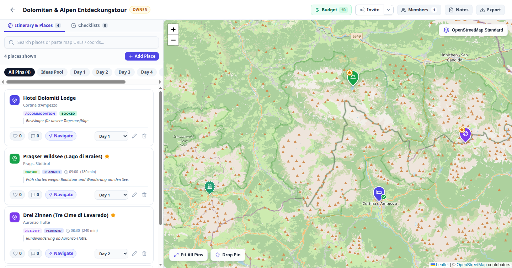

# 🗺️ POI Studio — Collaborative Trip & POI Planner

> **Minimalistischer, kollaborativer Reiseplaner mit interaktiver Karte, Tages-Routenplaner, Budget-Übersicht und Offline-Export.**

[](https://poi-studio-app.vercel.app)
[](https://nextjs.org/)
[](https://turso.tech/)
[](LICENSE)

👉 **[Hier direkt live ausprobieren: https://poi-studio-app.vercel.app](https://poi-studio-app.vercel.app)**  
*(Einfach einen Benutzernamen eingeben und sofort losreisen – kein Passwort-Zwang!)*

---

## 📸 Screenshot



---

## ✨ Features im Überblick

* 🗺️ **Interaktive Karte ohne Key-Zwang**: OpenStreetMap als Standard (sowie CartoDB Voyager, Dark Matter & OpenTopoMap). Vollständig ohne bezahlte Google Maps APIs.
* 📍 **Smarte Ortssuche & Pin-Drop**: Komoot Photon Autocomplete, Koordinaten-Erkennung sowie direkter Import aus Google/Apple Maps & OpenStreetMap-Links.
* 📅 **Tages-Itinerary & Workload-Analyse**: Zeitfenster, Tagesplanung, automatischer Nearest-Neighbor TSP-Routenoptimierer und visuelle Tagesauslastungsbalken mit Überlastungswarnung (> 10h).
* 👥 **Einfache Kollaboration**: Teile Reisen per Einladungs-Link (`Owner`, `Editor`, `Viewer`), stimme im Team über POIs ab (Upvoting) und nutze Kommentar-Threads.
* 💰 **Budget & Spesen**: Kosten pro Person oder Gesamtbetrag erfassen, Währung einstellen und wer was bezahlt hat im Blick behalten.
* ✅ **Gemeinsame Checklisten**: Kategorisiert nach *Vor der Reise*, *Packliste* und *Dokumente* mit Zuweisung an Mitreisende.
* 📄 **Druckbarer Offline-Reiseführer**: Speziell gestaltetes Druck-Layout (`@media print`) mit Tagesübersicht und Checklisten für unterwegs.
* 📦 **Volle Datenportabilität**: Export als **GPX** (Garmin, Komoot, Outdooractive), **GeoJSON**, **iCalendar (.ics)** und **JSON-Vollbackup** (inkl. Wiederherstellung).

---

## 🚀 Lokale Entwicklung

```bash
# 1. Repository klonen
git clone git@github.com:karoc123/poi-studio-app.git
cd poi-studio-app

# 2. Abhängigkeiten installieren
npm install

# 3. Entwicklungsserver starten
npm run dev
```

Die App ist sofort unter `http://localhost:3000` erreichbar. Die lokale SQLite-Datenbank (`local.db`) wird automatisch initialisiert.

---

## 🧪 Tests

Das Repository enthält eine automatisierte E2E- und Spezifikationstestsuite mit 81 Tests über 4 Tiers (Feature-Coverage, Grenzfälle, Cross-Feature-Kombinationen und reale Nutzerszenarien):

```bash
# Alle 81 Tests ausführen
npm test

# Oder gezielt nach Tiers filtern
node tests/runner.js --tier=1
node tests/runner.js --help
```

Details zur Testsuite findest du in [docs/TESTING.md](docs/TESTING.md).

---

## 🚢 Deployment

POI Studio kann überall betrieben werden — von einem Raspberry Pi zu Hause bis hin zur globalen Serverless-Cloud:

* **Vercel + Turso Cloud**: 100% kostenlos und serverless (bereits vorkonfiguriert via `@libsql/client`).
* **Docker Compose**: Ein-Befehl-Start mit persistentem Volume (`docker compose up -d`).
* **Bare-Metal Linux**: Systemd-Vorlage für VPS oder Mini-PCs vorhanden.

Ausführliche Anleitungen für alle Varianten findest du in der [DEPLOYMENT.md](DEPLOYMENT.md).

---

## 📚 Dokumentation

* [Funktionsspezifikation](docs/FEATURES.md)
* [Architektur- & Anforderungsübersicht](docs/description.md)
* [Testsuite-Architektur](docs/TESTING.md)
* [Deployment-Leitfaden](DEPLOYMENT.md)
